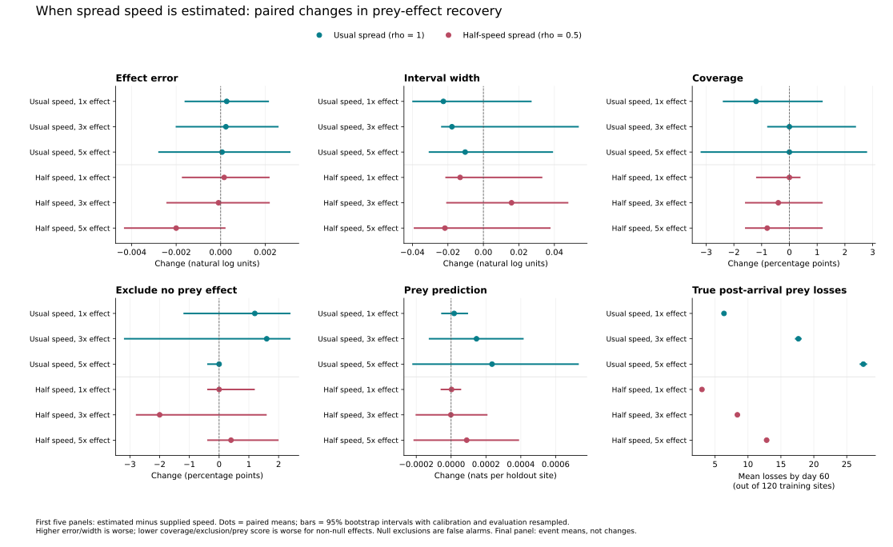
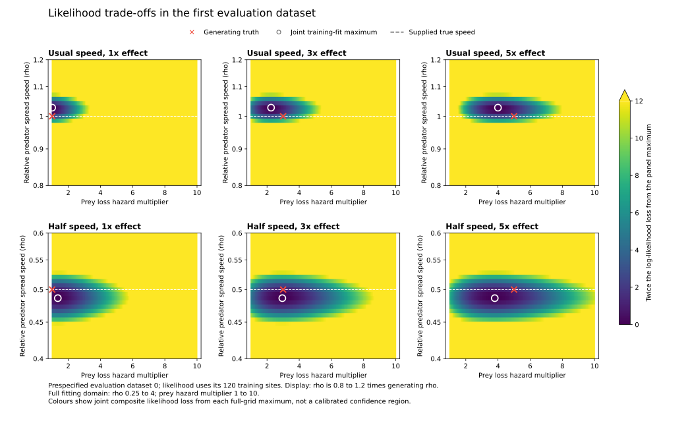

# Goal 045 synthesis: the cost of estimating predator spread speed

8 September 2026. Arc 2C, Charter Pillar 2. Scientifically accepted after
[independent final review](final-review.md).

Across the six frozen synthetic conditions, estimating predator spread speed
produced no detected systematic deterioration in prey-effect recovery relative
to supplying the true speed. All 30 paired 95% bootstrap intervals include zero.
The estimated changes are small, but this is not an equivalence test: the
intervals still allow modest costs, and the comparison conditions on known
detection, known background hazard and one fixed landscape and survey design.

This completes the intended process-oracle comparison. It does not establish
that prey effects are always recoverable.
Both analyses are weak for the threefold cases and the slow fivefold case.
The usual-speed fivefold case meets the descriptive effect-error, width and
exclusion benchmarks, while its interval coverage is below nominal in both
analyses. That shared limitation is distinct from a cost of estimating speed.

## Paired result

The [six-case table and methods](results/report.md#primary-paired-changes) give
all five primary contrasts with uncertainty. Changes are estimated minus
supplied speed. Mean absolute log-error changes range from -0.00200 to +0.00027;
mean log-width changes range from -0.02256 to +0.01585. Coverage changes range
from -1.2 to 0 percentage points. Non-null exclusion changes range from -2.0 to
+1.6 points; the usual-speed null has 1.2 points more false exclusions, and the
slow null is unchanged. Conditional prey prediction changes range from
-0.0000014 to +0.000235 nats per holdout site.

The most adverse marginal 95% bounds across the relevant case/metric contrasts
still allow an added 0.00314 log-error units, 0.05376 log-width units, a 3.2-point
loss of coverage or non-null exclusion, a 2.4-point increase in false exclusion,
or a 0.000223 nats/site loss of conditional prey score. These are distinct
intervals, not a simultaneous region or a prespecified equivalence margin.



Dots and bars show paired means and calibration-aware 95% bootstrap intervals.
The first five panels quantify added estimation cost; the final panel gives
true post-arrival prey losses among 120 training sites. The 1000 resamples draw
whole calibration and evaluation datasets separately, with each set of indices
shared across all cases and analyses. Cutoffs are recalculated in each resample.
No sites are treated as independent bootstrap units.

## Absolute recovery and the ecological interpretation

Each cell below reports supplied / estimated speed. Errors and widths are
medians in natural-log units; coverage and exclusion are evaluation proportions
expressed as percentages. The full [condition table](results/condition_summary.csv)
contains bootstrap intervals, Wilson intervals and support-topology diagnostics.

| Case | Effect error | Effect log width | Coverage (%) | Excludes 1x (%) |
| --- | ---: | ---: | ---: | ---: |
| usual_1 | 0.000 / 0.000 | 0.718 / 0.693 | 96.0 / 94.8 | 4.0 / 5.2 |
| usual_3 | 0.223 / 0.216 | 1.136 / 1.109 | 94.0 / 94.0 | 82.4 / 84.0 |
| usual_5 | 0.163 / 0.160 | 0.758 / 0.748 | 91.6 / 91.6 | 100.0 / 100.0 |
| slow_1 | 0.000 / 0.000 | 1.012 / 0.993 | 95.6 / 95.6 | 4.4 / 4.4 |
| slow_3 | 0.294 / 0.288 | 1.585 / 1.602 | 97.6 / 97.2 | 49.2 / 47.2 |
| slow_5 | 0.227 / 0.231 | 1.260 / 1.235 | 94.0 / 93.2 | 92.4 / 92.8 |

The usual fivefold case covers truth in 229/250 datasets in each analysis:
91.6%, with a 95% Wilson interval of 87.5–94.4%. When calibration-sample
variation is included, bootstrap coverage intervals widen to 86.4–97.6% with
supplied speed and 85.2–98.0% with estimated speed. This observed undercoverage is
reported, not removed by retuning; the goal did not require every descriptive
coverage interval to contain 95%. False-exclusion rates in the no-effect
controls are 4.0% / 5.2% at usual speed and 4.4% / 4.4% at half speed. Their
Wilson intervals are in the detailed report. Null boundary contact at effect=1
is expected, and exclusion there is a false alarm.

True post-arrival losses average 17.66 versus 8.39 sites for usual versus slow
spread at a threefold effect, and 27.52 versus 12.83 at fivefold. These totals
include background losses occurring after arrival; they are not counts of
losses causally attributable to predators. The event-yield contrast is
consistent with the slower wave leaving less informative exposure within the
survey window, but it does not isolate the mechanism responsible for recovery.
Truth-assisted event diagnostics never enter fitting or calibration.

Estimated rho has median absolute log error 0.02773 at usual speed and 0.04159
at half speed, with median log widths 0.18022 and 0.19408 respectively. Coverage
is 96.4% (241/250) in all usual-speed cases and 92.4% (231/250) in all slow cases;
these share predator histories and are not three independent confirmations.
All evaluation rho supports are connected and avoid the domain boundaries.
Rho cutoffs are approximately 45.2–45.8 and 20.1–20.3, respectively: the raw
site-marginal composite likelihood requires its own local calibration, not an
assumed chi-square cutoff. Its narrow peak does not validate uncalibrated
likelihood-ratio inference.



These are the first evaluation histories, selected before inspection. Colours
show twice the joint composite log-likelihood loss from the full-grid maximum;
they are not confidence regions. Both speed rows use the same relative display
range (0.8–1.2 times truth); fitting used rho=0.25–4 and effect=1–10. The figure
illustrates likelihood shape in those histories, not ensemble-wide geometry.

## Numerical acceptance and provenance

The accepted integration bank contains 65536 arrivals, verified against a nested
131072-draw replay of the identical 250 calibration and 250 evaluation histories
in every case. The [final numerical decision](numerical-decision.md#final-numerical-decision-8-september-2026)
records both passing check families. Maximum full-ensemble rho-cutoff movement
is 0.12431 LR against a 0.5 limit; support endpoints move at most one G201 cell,
with unchanged coverage counts, components and boundary classifications. The
four-history canary also passes. Earlier 16k/32k and 32k/64k tail-cutoff failures
remain recorded. No tolerance was relaxed and no biological setting changed.

The 201-point rho grid was selected after the original grid failed before
production; local midpoint checks then passed. Reported intervals are discrete
grid supports, with widths spanning their extrema. Continuous-profile endpoints
have not been validated. The bank comparisons establish bounded numerical
stability here, not exact integration or independent scientific replication.
Bootstrap uncertainty conditions on the accepted bank; it does not include
variation among independent integration banks.

Frozen campaign source: `e8c08f10f7b67118a85ee37770d8ee48ee2c213a`.
Accepted bank SHA-256:
`6e5ca1d19c1f825f608453c5692cfb8e327b11ed19208e232f5309658b2cb833`.
Accepted profile bundle SHA-256:
`68cb9acc72e07589d6ab752841dba74313a1f1d9d4a297923f560d586f07d8ad`.
Reference profile bundle SHA-256:
`fb215d517cc19733772fe56700a7d00041be04f304cabefe6ff0689479f6fce4`.

The 65536 run retains its original `timing` mode and nonproduction receipt,
because it was launched as a numerical reference. It nevertheless contains
the full scientific ensembles; the explicit final amendment in [Goal.md](Goal.md)
accepts those profiles as the scientific evidence. Only the current bank-size
default changes; no frozen output or receipt was rewritten. The generated
`bridge_complete` label alone is not the scientific acceptance decision.

Raw profiles, seed records and run receipts remain outside Git at
`artifacts/goal045_execution/reference65536/output/` and
`artifacts/goal045_execution/reference131072/output/`, with remote copies under
`deep-server-ts:/data/codex/scratch/goal045-full-bank-reference64-20260906-e8c08f1/`
and `deep-server-ts:/data/codex/scratch/goal045-full-bank-reference128-20260907-e8c08f1/`.
The original 16384 source checkout is retained at
`/data/codex/artifacts/goal045-production-16384-20260906-e8c08f1/source/`.
Compact final tables, figures and summary are committed under `results/`;
no banks, raw profile arrays or virtual environments are published.

Regenerate the review bundle from the accepted local profiles with the current
source (after retrieving the raw files if using a fresh clone):

```bash
uv run --locked python scripts/synthesize_arc2c.py \
  --input-dir artifacts/goal045_execution/reference65536/output \
  --output-dir artifacts/goal045_execution/reference65536/synthesis \
  --bootstraps 1000
```

## Scope and stopping boundary

This six-case bridge relaxes only knowledge of spread speed. Resistance,
detection and background hazard remain known, realised predator arrival remains
latent, and all fits use the same 120 training sites. The 40 holdout sites only
evaluate prediction: their predator observations are permitted conditioning
inputs, while their prey observations only score the fitted predictions.
Parameter-specific calibration still uses the generating condition. The result
is conditional on this synthetic model, landscape and observation schedule;
it is not field-ready calibration or evidence about real predator-prey systems.

The active path is already compact: design, shared-arrival likelihood, campaign
and synthesis modules, with three command-line entry points and focused tests.
A bounded consolidation review found no new superseded production runner to
retain or remove. Goal-specific diagnostic scripts and bulky replay payloads
remain outside the active package. No new abstraction or biological extension
is needed to complete this goal. Later changes to detection/background,
landscapes, observation designs or calibration methods require a new bounded
scientific decision; no next goal is launched here.

## Acceptance and verification

The independent final review passed without a material repair. It reconstructed
all 30 point contrasts and canonical 1000-bootstrap interval endpoints exactly
from the raw profile arrays, and independently reproduced both numerical
comparison families. An audit-only 10000-resample sensitivity check retained
all 30 zero-including intervals; it does not replace the declared 1000-resample
results. Twenty-four focused Arc 2C and shared Arc 2B kernel tests passed, as did
scoped formatting, Ruff, strict mypy and package build. Both rendered figures,
raw profile hashes, copied review artefacts and document links were checked.
Goal 045 is scientifically closed within its original six-case scope.
