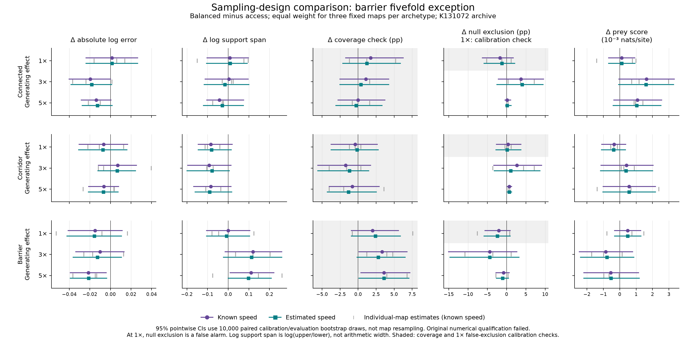
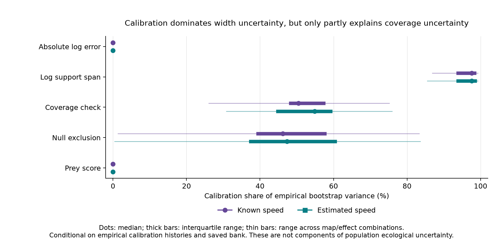

# Arc 3: no general sampling benefit resolved; barrier fivefold exception

18 September 2026. Closeout under Barry's delegated autonomous continuation;
independent review recorded separately. Charter Pillar 3. This is a conditional synthesis of
the completed synthetic comparison, with retrospective numerical sensitivity
checks; it is not a pass of the original numerical qualification.

## Scientific result and decision

No general sampling-design effect is resolved at this replication. The main
exception is the fivefold effect in the supplied barrier maps: balanced
sampling yields modestly lower point error and wider truth-calibrated
supports. This is a landscape-specific candidate finding, not a general
sampling advantage or an equivalence result. Most other substantive contrasts
remain unresolved; a small corridor exclusion contrast occurs near a ceiling.
Coverage and null-truth false exclusion are calibration checks and do not
support this scientific conclusion.

The decision is to close this bounded Arc 3 comparison with that
interpretation and its numerical limits. No process-bank enlargement or
fourfold calibration campaign is required for this conditional conclusion.
Such an extension could improve precision, but is not justified merely to
obtain a sharper significance classification. The original four numerical failures remain
failures; exact integration accuracy and adoption of a replacement integrator
remain unresolved. This completion is a reporting decision, not evidence that
the original integration method is generally qualified for later experiments.

## What was compared

The frozen design contains connected, corridor-dependent and barrier-dominated
landscapes, with three distinct map seeds arranged as seed-matched triplets
across archetypes. Connected and corridor maps share seeded geometry within a
triplet; the nine maps are not nine mutually independent landscape draws. Each
map compares two sampling strategies at equal effort: 120 training sites and
the same 40 reserved holdout sites, six surveys and two visits. The effect
multipliers are 1, 3 and 5, with true spread speed 1. Detection, background
hazard and resistance are known. Known-speed and estimated-speed analyses are
reported separately; their similar contrasts do not demonstrate equivalence.

The primary contrasts are balanced minus access, using equal map weights
within each archetype. Bootstrap confidence intervals resample whole
calibration and evaluation histories within each map and recalculate cutoffs,
preserving pairing across designs, effects and lanes. They condition on the
three supplied maps; they do not quantify uncertainty across unobserved
landscapes. Map ranges and leave-one-map-out point ranges accompany them.

The parameter support sets use truth-calibrated nominal 95% cutoffs (rank 239
among 250 calibration histories). This oracle calibration is unavailable to a
field analyst with unknown generating parameters. Same-truth coverage is a
calibration check, not a sampling-benefit endpoint or validation of operational
confidence intervals for unknown truth. Averaging over calibration and
independent evaluation histories, its tie-free benchmark is 239/251 for every
design, so the expected design contrast is zero. The same applies to null-truth
false-exclusion contrasts, with marginal false-exclusion benchmark 12/251.
Ties can make the inclusive rule conservative; a realised cutoff's conditional
coverage need not equal the marginal benchmark. These qualifications are
spelled out in the [calibration correction](calibration-interpretation-correction-2026-09-18.md).
Historical recovery classifications and all numerical results are preserved.

## Patterns in the archived results

At the fivefold effect in barrier landscapes, balanced sampling reduces the
equal-map mean absolute log error from 0.232 to 0.210 in the known-speed lane,
about a 9% reduction (roughly 10%). Mean log support span nevertheless rises
from 1.046 to 1.157. Point error improves in all three supplied barrier maps;
width changes are heterogeneous. The estimated-speed error contrast is similar
but is not an independent replication or evidence of lane equivalence.

The known-speed calibrated cutoffs are higher for balanced sampling in two
barrier maps (4.75 versus 3.51 and 5.17 versus 3.38 LR) and lower in the third
(4.18 versus 4.52). Wider supports accompanying lower point error show that
truth-calibrated width need not rank designs in the same way as point accuracy.
Width combines profile geometry with an estimated, design-specific cutoff.
The cutoff pattern is consistent with a contribution from calibration, but
these noisy upper-tail estimates do not establish greater LR dispersion as
its cause, nor does lower point error establish a formal information ordering.

Connected maps at a threefold effect show point estimates favouring balanced
sampling for error and common-target prediction, but the original 1000-draw
bootstrap interval bounds were extremely close to zero. Corridor maps at a
fivefold effect show a small increase in null exclusion, from about 99.3% to
100% in the known-speed lane. This is a change near a ceiling, not a large
sampling-design gain. The final precision review below distinguishes nominal
interval exclusions from exclusions sensitive to finite bootstrap sampling.

The absolute results help separate recovery from the comparison of strategies.
Across fixed-archetype/design means, threefold null-exclusion rates range
approximately 67–86%, while fivefold rates are about 97.5–100% across lanes.
The fitted effect model's mean conditional prey-score advantage over the
information-matched null is positive in the non-null conditions. This does not
make all sampling-design differences detectable or imply field transfer.

The figure shows pointwise intervals, not a simultaneous family of tests.
Coverage/exclusion are in percentage points. The shaded coverage panels and
null-truth exclusion rows are calibration checks, not sampling-benefit
outcomes. At non-null truths, exclusion describes power under the oracle
support procedure. “Log support span” means
`log(upper/lower)`, not arithmetic interval width. Exponentiating a difference
therefore compares geometric mean multiplicative spans, not ordinary widths.

## Landscape and event context

The barrier maps have geometric detour medians 1.45–1.51 and deterministic
unit-shock median arrival times about 95–108, compared with 51–79 for connected
maps and 46–53 for corridor maps. All have one source-reachable component.
Removing corridor quality raises median deterministic arrival by factors
1.19–1.56 in the corridor maps, versus roughly 1.02–1.07 in the other families.
These descriptors characterize the intended landscape contrast; nine maps do
not support a separate causal regression of recovery on each descriptor.

At a fivefold effect, training-site post-arrival extirpations average about
17.7–17.9 per history in barrier maps, versus 26.9–27.2 in connected and
27.3–27.8 in corridor maps, depending on sampling strategy. The smaller barrier
event yield is consistent with its weaker recovery. Post-arrival extirpations
include background events and are not counts causally attributable to the
predator. These truth-assisted descriptors never enter fitting or calibration.

## Numerical sensitivity and statistical precision

The 1000-resample archive audit reproduces Fable's 23/270 map-level percentile
interval exclusions. The registered equal-map archetype averages instead give
11/90 nominal exclusions. These are correlated outcomes, effects and lanes;
counting them is neither a global test nor a set of independent discoveries.
These audit counts include calibration checks and must not be read as counts
of ecological sampling effects.
No interval sign category changes between the archived K65536 and K131072
banks at either level. The largest point movement is 0.151 reference SE at map
level and 0.084 SE at archetype level. This establishes stability over that
nested-bank comparison, not an absolute error bound or a guarantee over other
integration choices.

All available original numerical evidence remains part of the result:

- two barrier boundary classifications changed by one support-grid cell;
- the connected calibrated-width contrast changed beyond its original limit;
- the corridor generating-speed tail LR exceeded its declared tolerance;
- Goal 047 isolated regulariser sensitivity in the connected stress case;
- the Goal 048 pseudocount-free pilot did not qualify corridor integration.

The sampled local grid-refinement checks passed, but there is no all-map
independent-bank or alpha-sensitivity qualification and no exact integral
reference. The present endpoint amendment permits transparent conditional
reporting of the archive; it does not replace missing accuracy evidence with
a claim of convergence. Conclusions about rho-tail accuracy remain unresolved.

The variance decomposition gives median calibration fractions of 97.6% and
97.6% for log-span contrasts in the known- and estimated-speed lanes. For
coverage the medians are 50.5% and 54.8%, with substantial map/effect variation.
Calibration contributes zero analytically to the point-error and predictive
score contrasts. Thus Fable's calibration-noise diagnosis is strongly supported
for width, but only partly describes coverage uncertainty.

These components are conditional on the empirical calibration/evaluation
histories and saved integration bank. They are not a decomposition of
irreducible ecological uncertainty. Replacing calibration variance by one
quarter suggests that four times the calibration histories could roughly
halve width SE under regular scaling, while coverage would improve much less.
That is a scenario, not a validated forecast for a discrete tail quantile.
The goal did not prescribe a precision target that makes such an extension
necessary for reporting this conditional result.

One apparently degenerate known-speed exclusion contrast has zero SE in the
1000 joint bootstrap draws but positive variance under exact conditional
evaluation averaging. A zero empirical bootstrap SE is therefore not an error
bound and must not be used as a denominator without an explicit fallback.

## Finite-bootstrap refinement and final review

The uniform rank-precision check found six of the eleven nominal archetype
exclusions sensitive to the finite 1000-draw bootstrap. One predetermined
10,000-draw resampling refinement was completed from the same archived
histories, with seed 20260918046 and the same pairing and recalibration rules.
It generated no new ecological history, calibration history, map or bank.
Original outputs remain preserved.

At both banks, nine of 90 archetype contrasts have nominal 95% percentile
intervals excluding zero. Seven retain exclusion under the pointwise
order-statistic uncertainty bands; two remain sensitive to finite bootstrap
rank uncertainty: known-speed barrier coverage at effect 3 (a calibration
check) and connected point error at effect 3. Neither is treated as a resolved
sampling-design finding. Of the nine nominal exclusions, three are coverage
checks, two are the same near-ceiling corridor power contrast in paired lanes,
two are barrier fivefold error, one is barrier fivefold span, and one is the
unresolved connected error contrast. Neither nominal
interval category nor rank-sensitivity category changes between banks.
The reduction from eleven to nine nominal exclusions is a computational
precision correction, not a change in the ecological evidence. No further
resampling was performed to chase an exclusion.

Selected known-speed contrasts at K131072 illustrate the result. Values are
balanced minus access and condition on the three supplied maps per archetype.

| Archetype, effect | Outcome | Contrast | 95% percentile interval | Bootstrap rank check |
| --- | --- | ---: | ---: | --- |
| Barrier, 5 | Absolute log error | −0.0215 | [−0.0390, −0.0041] | Exclusion retained |
| Barrier, 5 | Log support span | +0.1113 | [+0.0095, +0.2219] | Exclusion retained |
| Corridor, 5 | Null exclusion, percentage points | +0.67 | [+0.13, +1.33] | Exclusion retained |
| Connected, 3 | Absolute log error | −0.0197 | [−0.0401, −0.0000084] | Unresolved |

These are illustrative correlated contrasts, not independent discoveries or
multiplicity-adjusted findings. Retaining exclusion under the rank check
addresses only finite-bootstrap precision; it does not establish integration
accuracy, validity beyond the empirical bootstrap, or landscape-population
generality. The estimated-speed lane retains the barrier effect-5 error
contrast and the small corridor effect-5 exclusion contrast. Coverage rows
remain in the full numerical table solely as calibration diagnostics.

The independent review and final verification support closure **only as a
conditional synthesis with retrospective sensitivity checks**. The original
numerical qualification failed, exact integration accuracy remains unresolved,
and no replacement integrator is adopted. A future study requiring stronger
accuracy or generality claims must qualify its method for its own scope.

## Calibration checks and correction to the initial closeout

Across 108 effect-parameter conditions, mean observed coverage is 0.9471 with
sample SD 0.0189; null-truth false exclusion averages 0.0546. The tie-free
benchmarks are 0.9522 and 0.0478. Under iid continuous scores, the combined
calibration/evaluation SD for 250 histories in each set is about 0.0190.
The conditions share histories and lanes, so their aggregate is descriptive,
not an independent goodness-of-fit test.

The initial closeout incorrectly used coverage differences to support a
sampling-design trade-off. Fable's message 247 identified that error; both
Astra's synthesis and the internal review missed it. Coverage deviations may
reflect calibration/evaluation variation, tie conservatism or a pipeline
problem; they are not evidence of improved ecological information. Under the
tie-free marginal model, rejecting a zero coverage contrast is a false
positive. We do not assert that each observed rejection is provably a Type I
error in this discrete implementation.

The [correction and review addendum](calibration-interpretation-correction-2026-09-18.md)
records the estimand argument, the scope of the width interpretation and the
unchanged numerical evidence. No new simulation or bootstrap refinement was
required. The original numerical failures and conditional closure stand.

## Reproduction and evidence

- [Operating envelope and retrospective amendment](endpoint-amendment-2026-09-18.md) and
  [independent final review](endpoint-final-review-2026-09-18.md).
- [Original numerical diagnosis](final-bank-diagnosis.md) and
  [Goal 047 result](../047-integration-validation/results.md).
- [Map-level endpoint audit](../../../artifacts/arc3_endpoint_audit_20260918/nested_endpoint_comparison.csv),
  [archetype audit](../../../artifacts/arc3_endpoint_audit_20260918/archetype_contrasts.csv),
  [variance decomposition](../../../artifacts/arc3_endpoint_audit_20260918/variance_decomposition_k131072.csv).
- [Refined archetype intervals and sensitivity flags](results/archetype_contrasts.csv),
  [10,000-draw replay](../../../artifacts/arc3_endpoint_audit_20260918/bootstrap10000/refine.py) and
  [verification](../../../artifacts/arc3_endpoint_audit_20260918/bootstrap10000/verification.json).
- [Absolute recovery](results/absolute_conditions.csv),
  [landscape descriptors](../../../artifacts/arc3_endpoint_synthesis_20260918/landscape_descriptors.csv),
  [event descriptors](../../../artifacts/arc3_endpoint_synthesis_20260918/event_descriptors.csv).
- [Archive audit replay](../../../artifacts/arc3_endpoint_audit_20260918/audit.py),
  [table replay](../../../artifacts/arc3_endpoint_synthesis_20260918/build_review.py),
  [figure and rank-check replay](../../../artifacts/arc3_endpoint_synthesis_20260918/plot_review.py).

All source/input/output identities and checks are retained with these
artifacts. No source-model change, new process simulation, commit, push or
publication is part of this tranche. The existing integration prototypes are
preserved as unadopted methods; this review adds no new package infrastructure.
