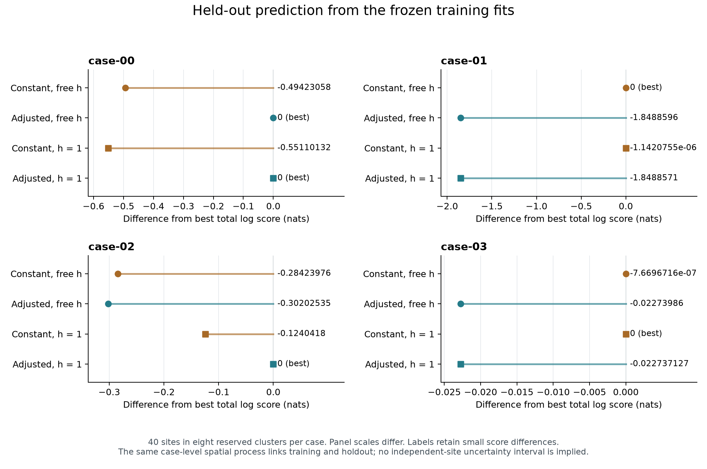

# Capstone training and held-out report, before truth release

8 October 2026, Hobart. Prepared by Codex (historically Astra). This report
combines the immutable blinded training report with the released holdout
comparison. Generating truths remain sealed. The independent review and final
report lock are recorded separately.

**Only the case-00 leading-pair forecast agrees with the held-out ordering.**
The three other pair forecasts miss under the previously committed exact-max
rule. The strongest training-based expectation reverses: in case-01, exposure
adjustment gained about 10.51 training nats but scores about 1.85 nats worse on
held-out prey observations. Some other predictive differences are tiny. These
are four descriptive checks of specified forecasts, each naming two of four
models; they are not an estimated forecast success rate or a test of the
sealed generating truths.

## Training inference remains fixed

The [locked training report](training-report.md) remains unchanged. All sixteen
main fits converged and passed the independent numerical diagnostics. The
primary adjusted effect estimates are h=1, 1, 1.287623619 and 1 for cases
00–03. Here h is the predator-associated prey-loss hazard multiplier. The
registered calibrated results remain four valid non-declarations,
**p_BB = 1, 1, 0.422 and 1**, with no abstention or diagnostic hold.

The calibration retains 33, 43, 107 and 128 nuisance nodes, respectively. Its
299-node union uses all 298,701 effect references, following the 75,735-reference
screen. No training fit, profile, candidate set, reference statistic or
declaration has changed after release. Likelihood-support profiles retain
their original interpretation; they are not confidence intervals. Conditional
casewise finite-grid control applies only to the registered exact-family
on-grid null and averages over observation and reference generation. It is
not four-case family-wise control, conditional validity for the realized
reference tables, or protection against B100-A misspecification.

A boundary estimate, non-declaration or superior h=1 predictive score does not
establish absence of an effect. Parameter recovery, generating-family identity
and the truth forecasts remain unassessed until the separate truth release.

## Released observations and unchanged scoring rule

Barry released the holdout on 8 October after Claude accepted the training
lock in thread-53 message 1054. The plaintext archive matched its prior SHA-256
commitment, including the 32-byte salt layout. An exhaustive check before
scoring found all 3,734 files in the training lock unchanged.

Each case has 120 training sites and 40 prospectively reserved held-out sites
in eight five-site clusters on the same public map. The score is the registered
conditional-prey log score for the held-out observation histories, including
all 13 prey occasions and conditioning on their predator observations. It is
a comparison at reserved sites, not a forecast into an unseen future period.
The held-out sites share the case-level spatial process with the training
sites. Site and cluster contributions are descriptive components of the score;
no site-IID or automatic cluster-IID standard error is used.

The [predictive specification](predictive-specification.md) and
[prereveal predictions](prereveal-predictions.md) retain their original hashes.
All four frozen models were scored for every case: constant or exposure-adjusted
background, each with h free or fixed at 1. Every model used its exact original
parameter vector, the qualified K=131,072 bank, whole-map normalization and
observation model. No refitting, model selection, profile-optimum substitution
or rounding of fitted parameters occurred. Higher log score is better under
this fixed conditional-prey rule.

## All held-out scores

| Case | Frozen model | Total log score (nats) | Mean per site (nats) |
| --- | --- | ---: | ---: |
| case-00 | Constant, free h | -389.553632823 | -9.738840821 |
| case-00 | Adjusted, free h | -389.059402239 | -9.726485056 |
| case-00 | Constant, h=1 | -389.610503554 | -9.740262589 |
| case-00 | Adjusted, h=1 | -389.059402239 | -9.726485056 |
| case-01 | Constant, free h | -455.868242370 | -11.396706059 |
| case-01 | Adjusted, free h | -457.717101921 | -11.442927548 |
| case-01 | Constant, h=1 | -455.868243512 | -11.396706088 |
| case-01 | Adjusted, h=1 | -457.717099502 | -11.442927488 |
| case-02 | Constant, free h | -388.113806781 | -9.702845170 |
| case-02 | Adjusted, free h | -388.131592373 | -9.703289809 |
| case-02 | Constant, h=1 | -387.953608817 | -9.698840220 |
| case-02 | Adjusted, h=1 | -387.829567019 | -9.695739175 |
| case-03 | Constant, free h | -496.908875290 | -12.422721882 |
| case-03 | Adjusted, free h | -496.931614383 | -12.423290360 |
| case-03 | Constant, h=1 | -496.908874523 | -12.422721863 |
| case-03 | Adjusted, h=1 | -496.931611650 | -12.423290291 |

Displayed values are rounded only for reading. The [full-precision totals and
means](holdout-results/totals.csv), [640 site contributions](holdout-results/site_contributions.csv),
[128 cluster contributions](holdout-results/cluster_contributions.csv) and
[24 pairwise differences](holdout-results/pair_differences.csv) retain the
complete comparison. All sixteen scores are available and finite.

The [vector figure](holdout-results/holdout_score_comparison.pdf) uses a separate
horizontal scale for each case; the tiny case-03 contrast should not be mistaken
for an effect comparable to case-01. Points at zero are exact saved maxima.
The four fitted candidates remain reported regardless of their rank.

## The committed predictive forecasts

A pair forecast is a hit only if the exact saved maximizing set intersects
its named pair. Exact co-winners remain co-winners. Every prediction nominated
two of four candidates, and none is reclassified after viewing holdout.

| Case | Predicted pair | Exact maximizing set | Pair outcome | Best score minus best predicted-pair score (nats) | Best-minus-runner-up margin (nats) |
| --- | --- | --- | --- | ---: | ---: |
| case-00 | Adjusted free h; adjusted h=1 | Both adjusted models | Hit | 0 | 0 (exact tie) |
| case-01 | Adjusted free h; adjusted h=1 | Constant free h | Miss | 1.84885713243 | 0.00000114208 |
| case-02 | Constant free h; adjusted free h | Adjusted h=1 | Miss | 0.28423976204 | 0.12404179820 |
| case-03 | Adjusted free h; adjusted h=1 | Constant h=1 | Miss | 0.02273712651 | 0.00000076697 |

The [forecast records](holdout-results/forecast_records.csv) retain the exact
winner sets, co-winners outside each predicted pair, and unrounded margins.
Case-00 has an exact tie because its two adjusted fits have identical parameter
vectors. Both are about 0.494 nats above the constant free-h fit.

Case-01 is a failure of the strongest comparative forecast. The fitted
exposure gradient and its 10.51-nat training gain did not predict superior
held-out scoring here. The two constant fits themselves are essentially
coincident: their 1.14e-6-nat score difference arises from distinct saved nuisance
estimates while both fitted h values equal 1. Their exact ranking has no claim
to substantive separation. The winning family's advantage over the best
forecasted adjusted fit is 0.0462 nat per held-out site.

Case-02 favored free-h models by only about 0.05 nat in training; the held-out
comparison instead places the adjusted h=1 fit first. Its advantage over the
best forecasted free-h fit is 0.2842 nats in total, or 0.00711 nat per site.
This reversal does not establish a null generating effect.

Case-03 is a very small disagreement with a deliberately weak forecast. The
constant h=1 fit leads the best adjusted fit by 0.02274 nats across 40 sites,
or 0.000568 nat per site. Its advantage over the constant free-h fit is only
7.67e-7 nats. All raw differences are retained; the numerical tie tolerance used
for checking score evaluation is not a statistical equivalence margin.

The held-out observations show why training ordering alone was an unreliable
basis for these four comparative judgments. They do not identify which
background mechanism generated a case, measure model adequacy, establish
transfer to new maps, or estimate power, coverage or general recovery rates.
The truth-class and parameter forecasts are unchanged and still awaiting truth.

## Independent verification and provenance

The main scorer uses the qualified compressed-bank conditional-prey path.
The independent auditor reconstructs the public inputs and evaluates the same
fixed vectors from the raw bank with the separate direct empirical-Laplace,
hazard and observation-emission implementation. It checks the input and fit
bindings, all site and cluster contributions, totals and means, all pairwise
differences, exact maximizing sets and forecast arithmetic. This is independent
score reconstruction conditional on the same numerical bank, not an independent
bank experiment or proof of exact integration over the stochastic spread law.

The completed numerical audit agrees on every winner set and pair-forecast
outcome. Maximum score disagreement is 5.69e-14 nats; the largest pairwise
contrast discrepancy is 1.14e-13 nats, below the existing 1e-8 numerical audit
tolerance. Seven targeted adapter/audit tests passed in the original Linux
runtime (Python 3.14.5, NumPy 2.5.1, SciPy 1.18.0). Main scoring used one process
and took 28.19 seconds, with 456.33 MiB maximum RSS. The execution record retains
exact source hashes, commands, resource receipts and both audit versions.

The [independent review](holdout-independent-review.md),
[execution record](holdout-analysis-2026-10-08.md) and
[complete-report lock](complete-report-lock.md) identify the final verified
files. The unchanged training root is
`2265d62e3e953792b2892a4d7b34c784d5800b2f7ba078db99ed753e13bd1861`;
the released holdout commitment is
`53903e56b0b86d8d713bf643d9c3062e8ce918fa8b84afa48f9b8ace6859fe6a`.

## Next release boundary

This report completes the registered training-plus-holdout interpretation
before truth is known. It is locked for Claude's review before Barry's separate
truth release. No truth plaintext, private key or private generating identity
was accessed. The later truth audit will evaluate the original effect-class,
h, branch, conditional beta, mean-hazard and detection-SD forecasts using their
committed scoring rules; it will not retrospectively repair a wrong forecast
or change the calibrated declarations.
