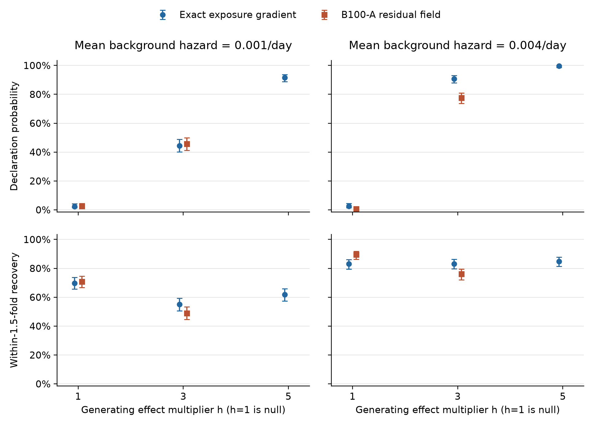

# Final observed-nuisance procedure: ten-cell operating-performance report

16 October 2026 (Hobart). Campaign completed on 15 October and passed independent
closure review on 16 October. This report advances Charter Pillar 4 and the final-procedure
evidence gap identified in the [Paper 1 synthesis](../../paper1-evidence-synthesis-2026-10-11.md).

The final procedure detects threefold effects in **44.4%** of exact-family
histories at mu=.001/day and **90.8%** at mu=.004/day, with corresponding null
declaration rates of **2.4%** and **2.6%**. Detection and magnitude recovery differ:
within-1.5-fold recovery at h=3 is **55.0%** and **83.2%**. At h=5, declaration
rates reach **91.6%** and **99.6%**, while recovery is **61.8%** and **84.8%**.
These are conditional operating properties of the registered final algorithm
on this fixed design and reference panel.

Under B100-A, h=3 declaration rates are **45.6%** and **77.6%**, alongside
matched h=1 rates of **2.6%** and **0.6%**. Recovery at h=3 is **49.0%** and
**76.0%**. This supplies a specified misspecification stress test; it does not
extend the exact-family guarantee or identify the cause of differences.

## Declaration and point recovery

L and H denote mu=.001 and .004/day; the suffix is generating h. B_ denotes
B100-A. Each entry gives count/500, percentage and pointwise 95% Wilson interval.

| Cell | Declaration | Within-1.5-fold h recovery | Valid error ≥1.5-fold |
| --- | --- | --- | --- |
| L1 | 12/500; 2.4% [1.4, 4.1] | 349/500; 69.8% [65.6, 73.7] | 151/500; 30.2% [26.3, 34.4] |
| L3 | 222/500; 44.4% [40.1, 48.8] | 275/500; 55.0% [50.6, 59.3] | 225/500; 45.0% [40.7, 49.4] |
| L5 | 458/500; 91.6% [88.8, 93.7] | 309/500; 61.8% [57.5, 66.0] | 191/500; 38.2% [34.0, 42.5] |
| H1 | 13/500; 2.6% [1.5, 4.4] | 415/500; 83.0% [79.5, 86.0] | 85/500; 17.0% [14.0, 20.5] |
| H3 | 454/500; 90.8% [87.9, 93.0] | 416/500; 83.2% [79.7, 86.2] | 84/500; 16.8% [13.8, 20.3] |
| H5 | 498/500; 99.6% [98.6, 99.9] | 424/500; 84.8% [81.4, 87.7] | 76/500; 15.2% [12.3, 18.6] |
| B_L1 | 13/500; 2.6% [1.5, 4.4] | 354/500; 70.8% [66.7, 74.6] | 146/500; 29.2% [25.4, 33.3] |
| B_L3 | 228/500; 45.6% [41.3, 50.0] | 245/500; 49.0% [44.6, 53.4] | 255/500; 51.0% [46.6, 55.4] |
| B_H1 | 3/500; 0.6% [0.2, 1.7] | 447/500; 89.4% [86.4, 91.8] | 53/500; 10.6% [8.2, 13.6] |
| B_H3 | 388/500; 77.6% [73.7, 81.0] | 380/500; 76.0% [72.1, 79.5] | 120/500; 24.0% [20.5, 27.9] |

All cells have **0/500 abstentions and 0/500 unavailable h estimates**
(per-cell 95% Wilson interval 0–0.76% for each). Valid non-declaration counts,
in table order, are 488, 278, 42, 487, 46, 2, 487, 272, 497 and 112; their
intervals and the full three-way partitions are in the
[unaltered machine summary](results/summary.json). Zero observed failures do
not establish a zero failure probability. Neither exact h=1 cell triggers the
registered conditional-null flag: its declaration interval is not wholly
above .05. B100-A comparisons with .05 are descriptive.

Figure: 500 histories per point; slight horizontal offsets separate background
regimes. No B100-A h=5 cell was registered. [Vector PDF](results/operating_probabilities.pdf).

## Magnitude errors and boundaries

Signed log bias is mean log(h_hat/h). Absolute-log summaries below have
whole-history bootstrap 95% intervals. Boundary counts are out of 500 valid
estimates, at the frozen h limits 1 and 10 respectively.

| Cell | Signed log bias | Mean absolute log error | Median absolute log error | Lower / upper h boundary |
| --- | --- | --- | --- | --- |
| L1 | 0.305 [0.266, 0.343] | 0.305 [0.266, 0.343] | 0.000 [0.000, 0.056] | 258 / 2 |
| L3 | -0.005 [-0.052, 0.044] | 0.435 [0.407, 0.463] | 0.361 [0.330, 0.399] | 20 / 4 |
| L5 | 0.037 [0.002, 0.072] | 0.355 [0.335, 0.377] | 0.297 [0.274, 0.325] | 0 / 48 |
| H1 | 0.159 [0.139, 0.182] | 0.159 [0.139, 0.182] | 0.000 [0.000, 0.014] | 264 / 0 |
| H3 | 0.014 [-0.011, 0.041] | 0.235 [0.220, 0.251] | 0.192 [0.171, 0.220] | 1 / 0 |
| H5 | -0.018 [-0.043, 0.007] | 0.230 [0.215, 0.245] | 0.195 [0.173, 0.216] | 0 / 4 |
| B_L1 | 0.290 [0.251, 0.326] | 0.290 [0.251, 0.326] | 0.000 [0.000, 0.042] | 261 / 0 |
| B_L3 | -0.006 [-0.054, 0.045] | 0.470 [0.441, 0.499] | 0.416 [0.365, 0.452] | 21 / 3 |
| B_H1 | 0.111 [0.095, 0.128] | 0.111 [0.095, 0.128] | 0.000 [0.000, 0.000] | 297 / 0 |
| B_H3 | -0.114 [-0.142, -0.086] | 0.272 [0.252, 0.292] | 0.212 [0.192, 0.247] | 1 / 1 |

The low-hazard h=5 cell reaches the upper h boundary in 48/500 histories
(9.6%). Its high declaration rate therefore coexists with appreciable
magnitude uncertainty and boundary contact. The h=1 lower-bound masses also
explain zero median absolute errors in the null cells; these do not show
precise estimation across positive effects. All registered .05, .25, .50,
.75 and .95 error quantiles and their bootstrap intervals, boundary Wilson
intervals, and recovery among declarations are retained in the machine
summary. Recovery among declarations is a selected-subset diagnostic.

## Held-out prediction

Values are mean paired conditional-prey log-score differences, in nats per
40-site held-out history, with whole-history bootstrap 95% intervals. Positive
values favour adjusted free h. Both primary pairs have **0/500 unavailable
pairs in every cell**; all reported means use 500 paired-valid histories.

| Cell | Adjusted free h − adjusted h=1 | Adjusted free h − constant free h |
| --- | --- | --- |
| L1 | -0.069 [-0.104, -0.034] | 0.040 [-0.079, 0.152] |
| L3 | 0.253 [0.150, 0.357] | 0.202 [0.071, 0.330] |
| L5 | 1.287 [1.116, 1.460] | 0.382 [0.225, 0.533] |
| H1 | -0.073 [-0.110, -0.037] | 1.361 [1.178, 1.546] |
| H3 | 1.141 [0.964, 1.316] | 1.924 [1.742, 2.116] |
| H5 | 3.319 [3.067, 3.581] | 1.957 [1.721, 2.200] |
| B_L1 | -0.085 [-0.117, -0.053] | 0.136 [-0.004, 0.268] |
| B_L3 | 0.221 [0.122, 0.321] | 0.336 [0.151, 0.518] |
| B_H1 | -0.078 [-0.106, -0.051] | 1.507 [1.277, 1.727] |
| B_H3 | 0.682 [0.519, 0.846] | 1.605 [1.326, 1.860] |

Free h modestly reduces mean prediction score against adjusted h=1 in all
four null cells and improves it in all six positive-effect cells. The
adjusted-versus-constant free-h advantage is most pronounced at higher hazard;
the L1 and B_L1 intervals include zero. These comparisons use the same fixed training
fits and reserved sites, without selecting a model using held-out outcomes.
All four candidate score summaries and all six pairwise comparisons are
available in the machine summary.

## Nuisance and between-cell diagnostics

Mean fitted mu deviations below are multiplied by 1,000 for readability;
their physical units are per day. Exact-family beta values are mean errors;
B100-A values are mean fitted working-model beta, marked with an asterisk,
because no generating adjusted-model beta exists. SD values are mean errors.

| Cell | Mean mu deviation ×1000 | Mean beta error / fitted beta* | Mean SD error | Median retained C size | Median p_BB |
| --- | --- | --- | --- | --- | --- |
| L1 | -0.009 | -0.052 | -0.0008 | 108 | 1.000 |
| L3 | 0.054 | 0.005 | -0.0009 | 109 | 0.061 |
| L5 | 0.028 | 0.022 | -0.0008 | 108 | 0.014 |
| H1 | -0.050 | -0.021 | -0.0005 | 41 | 1.000 |
| H3 | 0.052 | 0.004 | -0.0003 | 40 | 0.013 |
| H5 | 0.145 | 0.029 | 0.0004 | 39 | 0.011 |
| B_L1 | -0.022 | 0.521* | -0.0007 | 109 | 1.000 |
| B_L3 | 0.049 | 0.590* | -0.0005 | 109 | 0.061 |
| B_H1 | -0.227 | 0.542* | -0.0013 | 45 | 1.000 |
| B_H3 | -0.123 | 0.557* | -0.0006 | 46 | 0.017 |

Exact-family true-node retention counts are 490, 486, 491, 488, 498 and 490
out of 500 (97.2–99.6%). True-node retention is not applicable to B100-A.
Full nuisance distributions, bootstrap intervals, boundary contacts, retained
set sizes, p_BB distributions, candidate scores and numerical-status counts
are preserved in the machine summary; the B100-A fitted-beta distribution
is explicitly labelled as a working-model diagnostic.

The registered h=3 minus h=1 declaration differences are 42.0 percentage
points (95% interval 37.6–46.6) for L, 88.2 [85.2, 91.0] for H, 43.0
[38.4, 47.6] for B_L, and 77.0 [73.2, 80.6] for B_H. At h=3, the B100-A
minus exact difference is 1.2 points (−5.2–7.4) at low hazard and −13.2
(−17.4–−9.0) at high hazard. These are independent-cell descriptive
comparisons, not causal effects or equivalence tests. All eight registered
contrasts across all 18 metrics, including their pointwise intervals, are in
[between_cell_intervals.csv](results/between_cell_intervals.csv).

## Design and uncertainty

The [prospective registration](registration-2026-10-11.md) and
[ten-cell amendment](amendment-2026-10-11.md) specify 500 independent complete
histories in each cell. Exact-family cells cross h={1,3,5} with mean background
hazard mu={.001,.004}/day, holding beta=.50 and persistent prey-detection
SD=.20. B100-A cells cross h={1,3} with the same two mu values and use a fresh
registered spatial background field for each history. There is no generating
adjusted-model beta or true nuisance node under B100-A.

All cells use the same 6,048-cell map, public exposure, 120 training sites,
40 held-out sites, K=131,072 arrival bank and complete 765-node reference
panel. Four models are fitted to each training history: constant or
exposure-adjusted background, each with h free or fixed at one. The adjusted
free/null pair supplies the frozen observed-nuisance declaration rule. Truth
is used for evaluation, never fitting or screening. Main fits and all 5,000
audited decisions are locked before held-out scoring. Prediction uses those
fixed fits and the registered conditional-prey score, conditioning on held-out
predator observations within the same history.

Every declaration, valid non-declaration, abstention and recovery proportion
uses denominator 500. Within-1.5-fold recovery means
`abs(log(h_hat/h)) < log(1.5)` for a valid adjusted-free estimate. Recovery,
valid error of at least 1.5-fold, and unavailable estimates partition each
cell. A non-declaration does not establish absence of an effect; an h=1
boundary estimate is a permitted outcome.

Proportions have pointwise 95% Wilson Monte Carlo intervals. Continuous
summaries and paired held-out contrasts use the registered 2,000 whole-history
bootstrap draws per cell, resampling all 500 IDs before applying endpoint
validity. Intervals are Type-7 percentile intervals; any undefined draw makes
that endpoint's interval unavailable. Between-cell comparisons use independent
cell resamples at the same draw index, without pairing replicate IDs. These
intervals quantify finite-history simulation uncertainty conditional on the
one map, design, bank, algorithm and realised reference panel. Held-out means
use paired-valid histories; unavailable pairs remain counted out of 500, and
missingness may be informative. Between-cell contrasts are descriptive and
pointwise, without pooling or equivalence claims.

## Numerical audit and execution

The campaign completed the 466 missing effect-reference tables at their
original addresses: 465,534 new reference histories. Together with the 299
accepted tables, this supplies 764,235 effect-reference rows; the existing
75,735 screening-reference rows are retained. All new tables received the
registered exhaustive row/status/direct-score audit and sampled generator
replays. Reused results retain their original custody and receipts.

The original production attempt stopped on an auditor defect after all
reference work and 5,000 main-fit bundles had completed. Independently
reconstructed scores differed from stored scores only within the continuous
numerical tolerance, but values close to the fixed tie boundary produced
different discrete ranks. The [reviewed repair](rank-audit-repair-2026-10-15.md)
preserves independent continuous-score reconstruction and separately checks
rank arithmetic using verified canonical stored values. It changes no
scientific kernel, tie constant, threshold, seed, model or observation.
All earlier artifacts and the failed receipt remain intact.

Barry approved the repair and continuation on 15 October. Preflight verified
all 46,676 carried files, 354 frozen-source files, 165 qualification files and
the unchanged runtime. The continuation used 40 workers, leaving headroom for
unrelated Deep work, within the qualified maximum of 51. The original absolute
deadline remained 22:51 AEDT on 16 October and was not reset. The [execution record](execution.md)
retains exact bindings, resource receipts and the repair qualification.

All 20,000 main fits converged with finite scores, passed independent score
replay and nesting checks, and produced no registered numerical warnings.
All 5,000 decision audits and all 5,000 held-out audits passed. Maximum
absolute audit discrepancies were 1.137e-12 nats for main scores,
3.980e-12 for observed decision surfaces, zero for canonical rank probabilities,
and 4.548e-13 for held-out scores.

All **50 fixed diagnostic histories** (replicates 0–4 in each cell) passed
both audit integrity and profile/lattice geometry checks, with valid numerical
status; no failure-category cases needed adding. The maximum profile-minus-main
score gap was 4.093e-12 nats, and every lattice maximum was below the
corresponding main fit (largest gap −0.000134 nats). Profile and lattice replay
discrepancies were at most 1.137e-12 and 8.868e-12 nats. These finite checks
support the recorded fits without certifying global optimization or bounding
rare failures. Diagnostic fits never replaced main outcomes.

The continuation finished at **16:37:31 AEDT on 15 October**, exit code zero,
with no resource stop or surviving workers: **45 minutes 33 seconds**, peak
aggregate RSS **25.05 GiB**. This is continuation cost, not total campaign cost:
the original production attempt had already used **20.08 hours**, including
reference generation and main fits, before the audit defect. The repair,
qualification and intervening pause remain documented separately. No deadline,
replicate count, scientific tolerance, estimator or reference address changed.

The verified local return contains **76,283 files**. Its compressed archive
SHA-256 is `a79def387225709ab727d34b4b304cdfd865027d2e5d5cc1dc373336e4452d24`;
all returned file hashes match. All 466 new raw SQLite databases were
rechecked remotely and retained there. The 27,000 evaluation and 20,000
bootstrap seed addresses were independently regenerated and match their
preserved ledgers. [Closure provenance](results/closure-provenance.json)
records bindings, receipts, locations and compact-file hashes. The
[independent final review](final-review.md) records arithmetic reconstruction
and the scientific closure verdict.

## Interpretation boundary

The exact-family null guarantee averages over reference generation and
observations; this experiment measures rates conditional on one reference
realisation. The registered exact-null flag concerns a Wilson interval wholly
above .05 and does not falsify the marginal theorem. B100-A results describe
performance under the specified misspecification law, averaged over its fresh
fields and histories. Neither high nor low B100-A false-declaration rates
establish a misspecification guarantee.

Matched exact/B100-A cells differ in the generating hazard structure, its
heterogeneity and exposure relationship. Their contrast does not causally
isolate misspecification or identify a generating model family. The chosen
exact beta=.50 may be favourable; the two mu anchors do not represent a
general nuisance surface. B100-A beta estimates are working-model diagnostics;
fitted mu deviations are descriptive, not recovery of a guaranteed pseudo-true
parameter. Physical-h and detection-SD errors retain their stated descriptive
meaning.

Held-out scores concern reserved sites within the same realised process and
condition on predator observations. They do not establish transfer to a new
landscape or survey regime. Recovery among declarations is a selection
diagnostic. The fixed diagnostic subset does not bound rare optimizer
failures, and likelihood profiles are not confidence intervals. This campaign
does not estimate effect-magnitude coverage or close the separate landscape
generality and common competing-process-model gaps in Paper 1.
