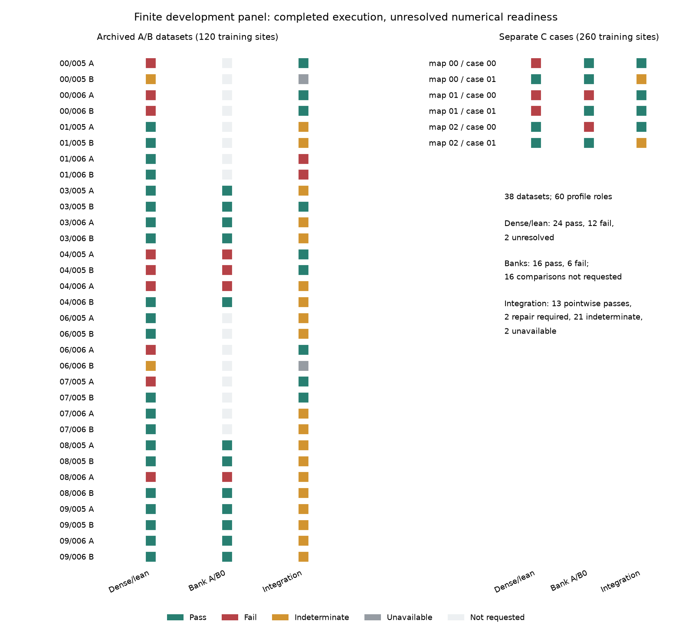
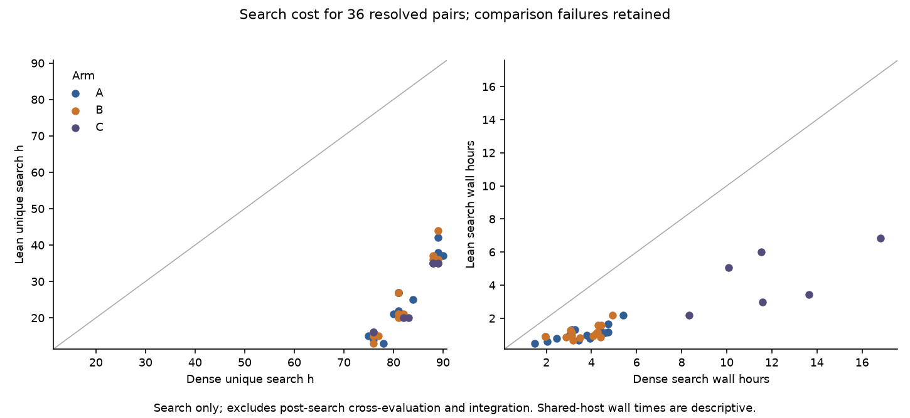
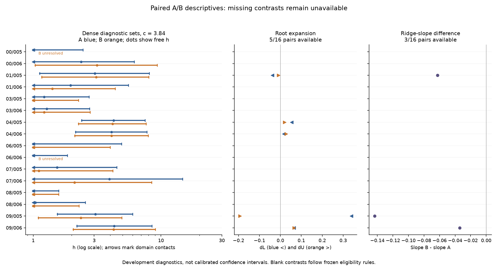

# Development challenge: completed panel, numerical readiness denied

5 November 2026. Synthetic development evidence; no calibration or production
qualification. This tranche advances the charter's uncertainty and generality
pillars and the broader integrated-method development programme. It leaves
the accepted Goal 062 ecological results unchanged.

All six arrival banks, 60 profile jobs, 36 eligible fixed-outer integration
screens and 22 independent-bank comparisons have finished. The panel does
not support promotion of the approximate spatial-profile procedure. Two
integration screens require repair, 21 remain indeterminate, and two cannot
be evaluated because their underlying searches remain unresolved. Search
and bank comparisons also retain boundary-contact failures under the frozen
rules. These are completed negative or indeterminate outcomes, not missing
jobs. [DC01–DC04]

The [frozen design](evidence/paper1-development-challenge-2026-11-01/design-freeze.md),
[post-freeze deviations](evidence/paper1-development-challenge-2026-11-01/post-freeze-conformance.md)
and [independent final review](evidence/paper1-development-challenge-2026-11-01/final-independent-review.md)
govern interpretation. The compact
[claim ledger](evidence/paper1-development-challenge-2026-11-01/final-claims.csv)
links the statements below to reproducible evidence.

## What finished

The panel comprises 16 archived biological histories, each observed as arms A
and B on the same 120 training sites, and six separately generated C cases
with 260 training sites. Arm B masks prey observations through day zero while
retaining the original cohort and predator observations. C uses three map
archetypes and two generating effects; it is a separate numerical stratum,
not a controlled estimate of the benefit of increasing site count.

The 38 B0 profile jobs compare independently started dense and lean searches.
Another 22 jobs fit dense references with independent bank A. All 60 roles
have verified evidence bindings. All six new arrival banks have 131,072 rows.
No failed case was replaced, no threshold was relaxed, and no new fit was
launched during final synthesis. Holdout observations remain excluded. [DC01]

| Diagnostic | Passed | Failed / repair | Indeterminate | Unavailable / not requested |
|---|---:|---:|---:|---:|
| Dense versus lean, 38 B0 datasets | 24 | 12 | 2 | 0 |
| Independent banks, 22 requested comparisons | 16 | 6 | 0 | 16 not requested |
| Fixed-outer integration, 38 datasets | 13 pointwise | 2 repair | 21 | 2 unavailable |

The original summary aggregates the 21 indeterminate screens and two
unavailable screens as 23 `indeterminate`. The tables and figures here expose
that distinction. The 22 independent-A dense profiles resolved, but are not
additional dense/lean passes. [DC01–DC04]



## Search and arrival-bank behaviour

The twelve dense/lean failures retain the frozen contact-agreement gate even
where likelihood curves and roots are very close. Across all 36 available
comparisons, maximum absolute W disagreement is 9.1632e-10 and maximum
absolute log-root movement is 2.4710e-6; all level-set and owner checks pass. A close criterion is not
permission to relabel a failed contact check as a pass. The unresolved cases
are `cell-00-rep-005-arm-B` and `cell-06-rep-006-arm-B`; their search envelopes
remain unresolved and their integration screens are unavailable. [DC02]

All 22 bank comparisons meet the numerical W and root tolerances and agree
on family ownership. The largest common-location W difference is 0.02335035
(limit 0.10); the largest absolute log-root movement is 0.0005074644 (limit
0.05). Six comparisons nevertheless fail nuisance-bound-contact agreement,
including discrepancies inside the diagnostic set. Those failures remain
part of the result. Arrival-bank sensitivity and latent-integration accuracy
are separate questions. [DC03]

Across the 36 resolved dense/lean pairs, the median number of unique search
h values is 81.5 for dense and 26 for lean. The median paired lean/dense
search-wall-time ratio is 0.312. These counts exclude post-search comparison
work; each location involves multiple numerical fits and tighter replay.
They do not establish a 10–15-fit procedure or production throughput.
Shared-host wall times are descriptive, and the twelve comparison failures
are retained in this cost summary. [DC06]



## Integration changes the readiness decision

Both repair-required results belong to `cell-01-rep-006`, arms A and B.
At 32,768 draws per point per stream, both independent streams satisfy the
weight and contrast-precision gates and the draw-doubling checks. At fitted
locations, importance integration changes the selected family from positive
spatial variance to exact zero variance beyond the frozen tie tolerance.
This is a material discrepancy, not merely insufficient Monte Carlo precision.

Arm A also has a fixed-outer centred W correction of +0.1071040121 at
h=5.57219546, outside the allowed ±0.10 band. Both conservative correction
intervals collapse to that value because the exact-zero family dominates
both envelope endpoints. Arm B's largest correction is about 0.04502; its
ownership reversal independently triggers repair. These arms share one
biological history and are not two independent ecological replications. [DC04]

The 21 completed indeterminate screens reach the frozen 262,144-draw cap.
Most lack contrast precision, with some also failing weight/tail checks.
`cell-08-rep-006-arm-B` instead has sufficient precision and weight behaviour,
but its upper-root correction intervals straddle 0.10: approximately
[0.09682, 0.11532] and [0.09981, 0.11675]. It remains indeterminate.

Every screen holds outer parameters at their Laplace-fit values. Neither
the repair decisions nor the 13 pointwise passes quantify movement of an
optimised marginal profile or its roots. The frozen design explicitly stops
before expensive reoptimisation when the first-stage panel already denies
readiness; that stopping condition has been reached. No second-stage
importance-profile campaign was added. [DC04]

## A/B observations are descriptive and incomplete

Only five of sixteen pairs have two actual diagnostic roots in both arms.
Two satisfy the predicted upper-versus-lower expansion direction, dU > dL;
three do not. Only three pairs meet the frozen ridge-slope eligibility rules;
all three have slope B − slope A < 0, contrary to the proposed direction.
Truncated, tied and unresolved cases remain categorical; missing roots are
not replaced by domain endpoints. Free sigma values, their zero/tied/boundary
categories, roots and ridge categories are retained for every dataset. [DC05]

These selected development histories do not establish the depletion account
as a general explanation. The narrow diagnostic sets in some cases also
cannot be interpreted as calibrated effect intervals while integration and
numerical readiness remain unresolved.



## Decision and next scientific tranche

Close this finite challenge as completed development with numerical blockers.
Retain the frozen failures and all indeterminate cases. Do not promote the
spatial-profile approximation, estimate coverage from these selected histories,
or launch production calibration from this result. [DC01–DC05]

The highest-value next tranche is a separately reviewed diagnosis of the
positive-versus-zero family integration discrepancy, alongside a bounded
audit of nuisance-contact classification near the zero-variance boundary.
The latter may expose an implementation or definition issue, but the current
record does not adjudicate it and no gate was changed. Any revised method or
gate must record that outcomes have already been seen and face a new,
explicitly designed numerical challenge. Monte Carlo precision failures
remain a separate computational problem.

## Reproduction and archive

Scientific execution source is preserved at `75e2eac627c89fa91bc5dda220245c65b80b6690`;
the pre-execution freeze is anchored at `8762a70`. Final synthesis adds
reporting only. The completed archive contains 3,406 files and
2,745,002,175 bytes. Source hashes before and after copying and all archive
hashes matched. Its inventory SHA-256 is
`5df8591f83e970f458ed468da44522c4142f16e673fac3d6f9d4b26607e1edf7`.
Bulk evidence remains in the project archive; access details belong in the
private compute allocation record. [DC07]

The public compact package contains [dataset results](evidence/paper1-development-challenge-2026-11-01/final-datasets.csv),
[paired contrasts](evidence/paper1-development-challenge-2026-11-01/final-paired-descriptives.csv),
[all 60 profile roles and hashes](evidence/paper1-development-challenge-2026-11-01/final-profile-roles.csv)
and [counts and source hashes](evidence/paper1-development-challenge-2026-11-01/final-counts.json).
After restoring the archived checkout with its original relative layout,
regenerate the canonical summary with the frozen summary job manifest; that
manifest contains execution-host absolute paths and must be restored at its
recorded location or translated explicitly without changing file hashes.
The compact tables and three figures reproduce from the canonical summary:

```sh
uv run python docs/evidence/paper1-development-challenge-2026-11-01/render_final.py \
  --summary artifacts/paper1_development_challenge_20261101/completed-review/summary-final/summary.json \
  --output-dir docs/evidence/paper1-development-challenge-2026-11-01
```

Final verification reproduced the canonical summary and both canonical CSVs
byte for byte with the unchanged summarizer. All 2,182 locally transferred
JSON/CSV evidence files match the completed archive inventory. The ten
existing summary tests pass, the reporting script passes Ruff, and all three
rendered figures were visually checked. Nectar has returned to its standing
allocation with hub services verified; its operational receipt is maintained
in the private control plane.

Codex (GPT-6 Astra) integrated the final synthesis; an independent native
Codex subagent audited receipt bindings, gate decisions and descriptive
arithmetic. The [reviewed correspondence snapshot](correspondence/INDEX.md)
preserves earlier Claude–Codex scientific discussion and disagreements.
