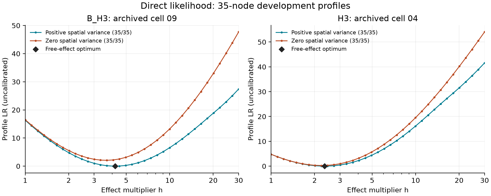

# Paper 1: differentiable arrival likelihood and direct spatial profiles

31 October 2026. Numerical development advancing charter pillars 3 and 4 and
continuing the [arrival-bank review](paper1-bank-review-2026-10-31.md).
Barry's instruction, “Claude has replied, and conceded your points. Onwards!”,
authorised the agreed sequence: efficient differentiable scoring, whole-profile
checks, then independent-bank sensitivity. This record covers the first two
stages; it does not reopen Goal 062 or register the broader experiment.

## Model and numerical method

The new `differentiable_likelihood.py` evaluates the existing empirical arrival
law, including its seven point pseudo-arrivals and K+7 denominator. Every
observed-history probability is decomposed into positive event and terminal
components. The evaluator returns the site log likelihood and its first three
analytic derivatives in log background hazard. It uses the existing positive
power moments where a derivative-moment truncation bound supports them, and
the same empirical sum over raw arrivals elsewhere. It introduces neither a
hazard cap nor a smoothed arrival distribution.

Survival transforms and within-category transition transforms are evaluated
once per site/category and reused across observation intervals. Mixture
curvature and third derivatives use centred cumulants. An exact-input,
one-entry cache avoids recomputing identical latent vectors. Unsupported prey
calendars use raw arrivals; missing predator visits, initial states and cohort
conditioning retain their existing definitions.

`SpatialProfileCriterion` now accepts a direct evaluator in place of spline
curves. Raw-backed evaluation removes the artificial interpolation-domain
restriction. It preserves the two latent-mode starts, nuisance bounds,
positive-variance and exact-zero-variance families, analytic core Laplace
gradients and existing optimisation tolerances. The legacy receipt field
`proposal_grid_supported` means numerical evaluator-domain support for direct
runs. Its four-marginal-SD diagnostic is not a joint-tail probability bound or
an importance-sampling accuracy certificate.

## Component verification and independent review

The independent reviewer found an h=1 error in the initial series construction:
positive-degree terms had survived at zero series argument. The corrected
implementation has a dedicated regression against the exact raw law. Review
also rejected a representation that duplicated millions of degree terms across
calendar components. The final structure reuses each category transform and
avoids that persistent allocation. Parent review subsequently found that a
coarse calendar such as (0,20,40,60) passed an insufficient series-domain check;
the repaired gate routes it to raw evaluation, including at h=1.

The real B_H3 check uses all 120 training sites and K=131072 raw arrivals,
with the matching order-192 compressed bank. At the previous fitted point,
site log values differ from the raw log-domain reference by at most 3.56e-15;
the first three derivatives differ from the analytic raw evaluator by less
than 9e-15. The formerly underflowing `cell_35_04`, at h=30 and log hazards
-2, -.9375, -.875 and 0, remains finite and agrees with the independent
log-domain reference within 2.28e-13.

High-x checks use the matching order-816 moments and raw bank at x=150 and
289. Third-derivative floating-point differences are larger than value errors,
reaching roughly 1e-9 in the independent check. The truncation bound explicitly
excludes floating-point roundoff; it is not a total derivative-error guarantee.
The evidence includes full-criterion gradient comparisons to test the
third-derivative contribution to the Laplace gradient.

At h=4.191586, 6.05348 and 30, all 18 centred-difference comparisons of the
alpha/beta/log-sigma gradient succeed. With the final guarded solver, the maximum discrepancy across both
step sizes is 2.10e-8. These checks re-solve the latent mode at perturbed parameter values.
They qualify the bounded derivative calculation, not three fitted optima.
The final focused suite passes 167 tests covering the new and reference
likelihoods, spatial engine, observation subsetting and monitoring design;
Ruff, strict mypy and the whitespace check pass.

The [evidence archive](evidence/paper1-direct-profile-2026-10-31/README.md)
retains source and input hashes, executable replays, receipts and the
[independent review](evidence/paper1-direct-profile-2026-10-31/review.md).

## Latent-mode solver optimisation

The first direct three-node B_H3 profile resolves both families and all nodes,
with h=4.195182, criterion -1716.447119663 and null LR=16.310599592. It takes
453.62 seconds and 78,022 evaluator calls. Its 2,110 latent-mode branches
average about 37 calls each: mode solving dominates the accelerated likelihood.

Before launching the full mesh, independent review approved trying the existing
12-step damped Newton procedure first. Failure returns to the existing
L-BFGS-plus-polish procedure from the original start. Both zero/warm starts,
best-branch selection and all scientific tolerances remain unchanged. The
prospective comparison gates are retained in the independent review.

An initial Newton implementation passed value checks but overshot into
expensive raw-bank evaluations and stopped paired finite-difference modes at
different residual sizes. Its failed performance check is preserved. The
reviewed correction limits each Newton increment to one log unit and attempts
one guarded correction after convergence, retaining the valid incumbent if
that correction fails. This is a step-length safeguard, not a hazard bound.

At seven archived outer parameter points, all 14 identical branch-start
comparisons pass. Maximum old/new log-hazard movement is 2.22e-10, penalised
mode-value movement is 2.28e-13 and Laplace-criterion movement is 4.01e-10.
These checks support the proposed solver ordering on the actual cases; they
do not prove global mode uniqueness. Matched refits and cross-evaluation at
all newly fitted parameter points also pass. The final three-node traversal
takes 173.17 seconds against 453.62 seconds originally; null-profile LR
movement is below 4e-11. Newton solves 98.0% of its branches without L-BFGS.

The h30 fit uses 42.25% of the original evaluator calls, missing the proposed
40% call target, although elapsed time falls to 53.4%. Independent review
accepts this explicitly recorded engineering miss because the extra polishing
calls remove demonstrated objective roughness. No scientific tolerance changes.

## Profile execution

The previously failing B_H3 fixed-effect nodes now resolve in both variance
families under the unchanged projected-gradient threshold of .001:

| Fixed h | Positive-variance criterion | Projected gradient | Original seconds | Final seconds |
| --- | ---: | ---: | ---: | ---: |
| 3 | -1716.952013929 | .00000156 | 88.06 | 11.62 |
| 6.0534836 | -1717.053577020 | .0001079 | 37.10 | 21.97 |
| 30 | -1730.148412582 | .00000880 | 50.91 | 27.18 |

Timings include loading. The h3 comparison uses order-816 moments; the other
two use order-192. Each pair uses the same raw bank and observation history.
The final h6 and h30 fits make 807 and 752 raw-site evaluations outside the
series domain. Both resolve with no final criterion domain or
positive-definiteness failure; some trial Newton steps use the documented
L-BFGS fallback. At h=30 the fitted spatial SD reaches its upper bound of 2, so this
is a constrained optimum. The old h=6.05348 failure had projected gradient
.001803 against the same .001 threshold; no acceptance rule was relaxed.

All runs use observed training data only; the 40 held-out sites are excluded. Both bank representations must match in count, site order
and raw-array checksum. Runs retain all candidate statuses and unresolved
nodes rather than silently dropping failures.

## Completed mesh traversals

Both archived histories resolve all 35 nodes in both variance families. Both
free endpoints resolve, all envelope checks pass, and no retained unresolved
candidate or fixed node exceeds its selected free endpoint.

| History | Positive / zero variance nodes | Free h | Uncalibrated h=1 LR | Elapsed minutes |
| --- | --- | ---: | ---: | ---: |
| B_H3, cell 09 | 35/35 and 35/35 | 4.19518345 | 16.31059959 | 25.86 |
| H3, cell 04 | 35/35 and 35/35 | 2.34621715 | 4.77602236 | 15.91 |

These are single-thread Mac mini development timings; the runs partly overlap.
Peak process RSS is below .79 GB. B_H3 makes 32,782 raw-site evaluations and
H3 makes 5,605, explaining part of the runtime difference. The fitted B_H3
free endpoint has projected gradient .000962, close to but below the unchanged
.001 gate; H3 has .000101. Neither is an unconstrained global-optimum proof.

For each history, all 35 retained positive-variance nodes and the free optimum
were cross-evaluated with the original solver from two identical starts.
All 72 points and 144 branch comparisons pass the prespecified 1e-8 criterion
and 1e-6 log-hazard tolerances. Exact maxima are retained in the comparison
receipts. This supports finite-mesh solver equivalence, not global uniqueness.

Positive spatial SD reaches its upper bound of 2 at h>=22.222 for B_H3 and
h>=18.193 for H3. H3 also reaches the lower positive-SD bound at h=1 and
1.105, where it nearly coincides with the exact-zero family. The free optima
are interior, so the documented free-h30 rounding defect does not affect
these selected endpoints. The former B_H3 result resolved only 18/35
positive-variance nodes; the arithmetic/support blocker is now cleared for
these two histories.

Points are evaluated mesh nodes; connecting lines guide the eye. These are
two numerical development histories, without calibrated cutoffs or confidence
intervals. The full runtime remains far from the six-fit-plus-profile target.

## Scientific limits and next decision

A completed 35-point traversal is not a certified continuous profile or a
calibrated confidence set. Root refinement, cutoff/topology stability,
independent-bank sensitivity, global-mode adequacy and comparison with a more
accurate integral remain separate qualification tasks. No fresh arrival bank,
600-case challenge, biological history or remote campaign is generated here.
The existing fitted nuisance bounds also remain part of the model; a resolved
boundary optimum must be reported as such.

Review found one pre-existing endpoint defect for the next qualification
tranche: this runtime evaluates `exp(log(30))` as `30.000000000000004`, which
the free-effect evaluators reject as outside [1,30]. Fixed-h30 mesh fits bypass
that transform. The defect is also present in the original solver and does
not affect an interior free optimum, but it needs a targeted repair and
regression tests for both variance families before upper-bound free-MLE cases
can be qualified. The frozen source is retained for these executions.

The six-model-plus-profile 20-second goal remains an engineering target.
Current Mac mini timings measure development code on one thread and cannot
price the full campaign. Reducing mode-solver evaluations and precomputing
calendar-component mixing are concrete performance follow-ups, subject to
preserving the criterion and its numerical checks.

Codex GPT-6 integrated the work. GPT-5.6 Sol specialist subagents implemented
and independently reviewed the kernel; GPT-5.6 Luna executed the bounded
benchmark adapter and profile checks. Claude supplied the peer proposal and
agreed the numerical sequence. Human review remains required before release.
