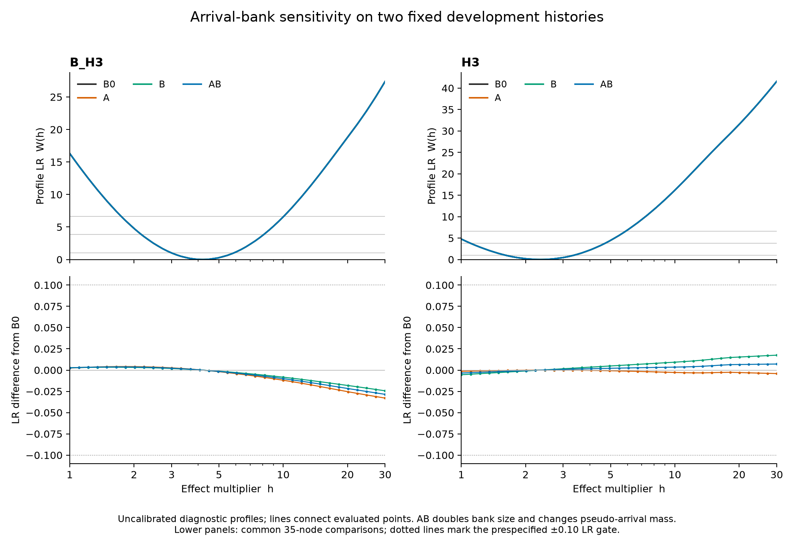

# Paper 1: endpoint, bank and continuous-profile qualification

1 November 2026. Numerical development advancing charter pillars 3 and 4 and
the broader model-comparison programme. Barry authorised the h=30 repair,
independent-bank sensitivity and continuous-profile qualification. Goal 062
remains closed. This record continues the
[direct-profile development](paper1-direct-profile-development-2026-10-31.md).

**Complete:** all eight profiles and all five bank comparisons per history pass,
with independent review. The largest common-anchor W difference is 0.03291853
(limit 0.10); the largest log-root movement is 0.000828072 (limit 0.05).
Neither pseudo-mass screen triggers a full refit. This is bounded numerical
qualification on two development histories, without a calibration claim.

## Prospective design and independent review

Claude's Correspondence message 2754 accepts the direct evaluator and completed
meshes and requests bank sensitivity. An independent methodological subagent
reviewed the following bounded design before fresh-bank results or refined
roots were examined. The two fixed archived histories (B_H3 cell 09 and H3
cell 04, replicate 000) retain 120 training sites, the original observation
calendars, covariance range, all nuisance bounds and both variance families.
Forty holdout sites are excluded. No new biological histories or outcome truth
files are used. The prior 35-node meshes are development evidence, not a
registered validation sample.

For each bank b, C_b(h) is the larger of the positive-spatial-variance and
exact-zero criteria; M_b is the selected free maximum over h in [1,30], and
W_b(h)=2(M_b-C_b(h)). Level sets W_b(h)<=c use fixed diagnostic levels
c={1,3.84,6.63}. These numbers carry **no nominal confidence or coverage claim**.

The original bank B0 has K=131072 rows. Fresh A and B use disjoint row
addresses K:2K and 2K:3K under the unchanged original seed rule
`SeedSequence([root,59,3,row]).generate_state(1,dtype=uint64)[0]`.
AB pools A and B at 2K. Public map/site inputs and the spread law remain fixed.
Equal-K comparisons are B0/A, B0/B and A/B; nested comparisons are A/AB and
B/AB. All seed addresses, seed values, input/source identities and row/site
ordering are retained. Original rows are not regenerated as a supposedly
independent bank.

## Numerical gates

- Every required family-point must have an eligible finite fit; failed
  candidates are retained. Both variance families must resolve,
  under the unchanged main projected-gradient threshold 1e-3. A retained
  unresolved candidate or fixed profile point above its selected family free
  maximum by more than 1e-4 forces refitting or an indeterminate result.
- B0 adds all 34 logarithmic midpoints to the existing 35-node mesh. Detected
  maxima, family switches and all cutoff crossings are refined. Fresh banks
  start from the same 35-node mesh, with default and neighbouring nuisance
  starts. Both families are refit at every new h.
- Fresh-bank midpoint checks cover intervals with a peak, cutoff crossing,
  family switch, nuisance-bound transition, branch disagreement above 1e-4
  criterion units, changed topology, or an endpoint within 0.25 LR of a cutoff
  without a crossing. Refinement reaches at least the baseline midpoint
  spacing in triggered intervals. All selected free peaks are reoptimised.
- Crossings are bracketed in log(h), then solved with Brent tolerance 1e-4.
  The free maxima and roots receive a separate tighter replay with projected
  gradient <=1e-4 and root tolerance 1e-5. Each root must have |W-c|<=.01;
  standard and tighter evaluations at the **same h** must differ in W by at
  most .01; corresponding log roots must differ by at most .005. Component
  counts and h-domain contacts must agree. Family differences within 1e-4
  criterion units are numerical ties, not ownership failures.
- The tighter replay includes the complete discovery mesh, not just the root
  brackets, plus all refined roots/free/switch locations. B0 additionally
  replays archived parameters at a 1e-8 criterion tolerance. Reoptimisation can
  improve an archived fit that only met the 1e-3 gradient gate: such improvements
  are reported separately, cannot reduce the best criterion by more than 1e-8,
  and must move W by at most .01 for the bounded replay comparison.
- Root calculations retain every detected component, including singleton,
  empty, full and unavailable sets. A failed bracket or fit never becomes an
  empty set. Mesh refinement supports finite-resolution topology only; it
  cannot prove absence of arbitrarily narrow unseen features or global modes.
- Each history/bank may use up to 160 distinct standard h points and 160
  tighter replay points. Exhaustion is indeterminate, not permission to omit
  a crossing. These are generous execution guards, not statistical targets;
  the 10–15-fit costing proposal is not adopted as a qualification algorithm.

## Bank sensitivity gates and pseudo mass

Apply the following casewise to all listed comparisons, without averaging
across the two histories: maximum common-anchor |Delta W|<=.10, every finite
root |Delta log(h)|<=.05, and identical component counts and h-domain contacts.
Movement in the fitted h is descriptive. Failure is a bank-sensitivity result;
it does not justify changing bounds, histories or thresholds after inspection.
Two histories cannot estimate the distribution of bank errors.

K-to-2K comparisons change both sampled arrivals and the total pseudo-arrival
mass, from 7/(K+7) to 7/(2K+7). Duplicate every empirical row of A to construct
Adup: its empirical distribution is unchanged, but it has nominal size 2K and
the same seven pseudo-arrivals. Resolve latent modes under Adup at A's fitted
free/anchor/root nuisance points. A centred LR-scale perturbation above .05,
projected gradient above 1e-3 or material non-tied family-ownership reversal
triggers a full Adup profile refit. Both family free optima and both family
parameter vectors at standard anchors and final tightly refined roots are
replayed. Otherwise this
is explicitly a fixed-fit pseudo-mass perturbation, not an optimised-profile
certificate. Adup/AB shares nominal K and pseudo mass.

Report h=1/30 contact as h-domain truncation, and nuisance-bound contact
separately at free maxima, crossings and sampled points inside each level set.
Bound contact alone does not establish that the bound determines an endpoint.
No nuisance bound is widened.

For the outer negative criterion, report q=g' H^-1 g when the reduced Hessian
is positive definite and adequately conditioned. The local estimated criterion
deficit is q/2, and its one-fit LR-scale contribution is q. This is a local
quadratic diagnostic, not an error bound or replacement for projected-gradient
qualification. It is distinct from the latent-mode Newton decrement.
The reduced Hessian must be finite, positive definite, have condition number
at most 1e10 and relative asymmetry at most .01 before symmetrisation. Results
at finite-difference scales 1e-4 and 3e-5 are reported together; unavailable
diagnostics do not imply that a finite-difference Hessian passed qualification.

## Endpoint repair and initial checks

The free log-effect is checked against [0,log(30)] before exponentiation.
The valid upper endpoint is clamped to h=30 to remove the floating-point
overshoot. Truly out-of-domain coordinates still fail, including adjacent
floating-point values and large positive inputs. Both variance families retain
their original parameter vectors and all KKT/optimiser tolerances.
The focused endpoint suite passes 37 tests plus Ruff and strict scoped mypy.
Independent audit accepts the repair.

Claude's x=8.58e55 question refers to the rejected **uncapped** Newton version,
source 888ab4d9. The adopted per-step cap limits each proposed Newton increment,
not accumulated log hazard or unchanged L-BFGS fallback. Adopted B_H3/H3 mesh
diagnostics still reach x=1.52e6/600.31, handled by raw evaluation. Independent
audit found no accepted nonfinite criteria, domain errors or final
positive-definiteness failures in those receipts. The old failed version remains
preserved and is not relabelled as the adopted implementation.

## Execution and scope

A local bank smoke test precedes the resource choice. BLAS threads are limited
to one; independent histories can run in separate processes within Mac mini
memory/CPU capacity. Receipts preserve failures, source hashes and partial
progress. Execution findings below retain these gates.

The original public loader failed before generating any bank: reconstructing
the frozen exposure differed by at most 8.88e-16 from the stored values.
All frozen files, seed identities and 17 reconstructed arrival-generating
arrays remained byte-identical. Independent review accepted an arrival-only
loader that validates those arrays and all frozen file hashes, without
reconstructing the exposure/setup that arrival simulation does not use.
It does not relax the original loader or its scientific checks. The exact
floating-point operation responsible for the exposure difference is not known.

The repaired 256-row smoke (two workers) completed in 5.73 seconds. Independent
replay of original rows 0, 1 and 131071 reproduced all 480 arrival values exactly.
All 393216 seed values across B0/A/B were unique; pairwise intersections were
empty. Fresh 2K generation uses four local workers and 256-row chunks, alongside
at most two single-thread profile processes. An execution-only resource
amendment permits up to four profile processes after generation finishes:
this uses fewer concurrent CPU workers than the initial six, and the live
Mac memory check showed 48% free during generation plus two profiles. All
BLAS libraries remain single-threaded; scientific rules and source bytes are
unchanged. The smoke forecast roughly 49 minutes for generation; the measured
completed runtime is reported below.

The proposed Arm-B pre-period ablation is deferred: it changes observation
design and asks a separate mechanism question. The observed h–sigma trade-off
is consistent with depletion-mediated confounding but does not establish its
cause. A later ablation needs an explicit masking and contrast specification.
Kunanyi throughput, 260-site behaviour, the 600-case challenge suite,
higher-accuracy integration and calibration remain separate work.

## First execution and reviewed refinement repair

The fresh 262144-row bank completed in 2484.88 seconds (41.41 minutes),
using addresses 131072:393216. All 109 source/input bindings match the
completed receipt. A, B and AB were derived and compressed separately at
order 192, preserving their own K+7 normalization.

The initial B0 H3 run completed in 4189.12 seconds (69.82 minutes), with
100 standard and 99 tighter points. Independent receipt review accepts its
within-bank numerical resolution: all three diagnostic sets have one detected
component; the c=6.63 set touches h=1. The 72 archived parameter replays
match exactly; maximum archived LR movement is 5.46e-12. The h estimate is
2.34621715. This remains a finite-resolution numerical check, without a
calibration or independent-bank precision claim.

B0 B_H3 stopped after 3329.13 seconds (55.49 minutes), with 76 standard and
no tighter points. Its preserved status is indeterminate. A hard-coded
three-round midpoint-refinement limit fired while refining the already-known
smooth peak near h=4.19518. The final midpoint h=4.21229 lies 7.51e-5 criterion
units below the free optimum but exceeds its bracket endpoints by 2.47e-4.
The remaining triggers contain only an interior peak, not a new crossing,
family switch or nuisance-bound transition. This is an execution failure,
not evidence of bank instability or an ecological result.

After observing that failure, independent review accepted a recorded
implementation deviation: remove the three-round limit and continue the
unchanged feature checks until they resolve or the existing prespecified
160-unique-point guard is exhausted. No fit, topology, root, bank-sensitivity
or calibration threshold changes. Preserve the original receipts and source;
run the amended implementation in new output directories. H3 B0 is also
replayed to retain the aggregator's exact-source comparison contract. Fresh
H3 A/B profiles may run alongside these two B0 replays within the existing
four-process resource amendment; joint acceptance still requires every
corresponding profile and the final bank/pseudo-mass gates.

Fresh H3 banks A and B completed their individual numerical checks in 63.40
and 57.44 minutes, respectively; independent receipt review accepts both.
The H3 fixed-fit pseudo-mass replay has maximum centred LR shift 0.000400641,
maximum projected gradient 0.000304479, and no material family-ownership
change. Independent reconstruction verifies all 120 bindings and the exact
A-receipt identity. No full H3 Adup refit is triggered. This is a fixed-fit
perturbation with latent modes reoptimised, not an optimised Adup profile
certificate. Pooled AB and cross-bank acceptance followed, as reported below.

An independently reviewed execution-order amendment permits fresh B_H3 A,
B and AB profiles after the repaired B0 B_H3 standard-root closure, while its
tighter replay continues, as slots open within the four-process limit. Each
runner consumes the frozen archived reference, not an unfinished B0 receipt;
there is no computational dependency on B0 completion. This changes execution
order only. Acceptance still requires all completed within-bank and cross-bank
gates. Histories, sources, banks and numerical thresholds remain unchanged.

## Completed numerical and bank qualification

All eight B0/A/B/AB profiles on the two fixed histories pass the within-bank
numerical checks. All five prespecified comparisons pass separately in each
history, including both pooled-bank comparisons. Independent result review
accepts the bounded numerical conclusion. These development histories do not
estimate the distribution of bank errors or validate calibrated confidence
sets. The original failed run and post-outcome implementation deviation above
remain part of this result.

The table reports each successful run's elapsed time, including its standard
refinement and tighter replay. Runs overlapped, so these are per-run times,
not total campaign wall time. Concurrency varied between runs, so these are
not controlled speed comparisons and do not establish production throughput.
The fitted h is the tighter free-envelope maximiser.

| History | Bank | Minutes | Standard points | Tighter points | Fitted h |
|---|---|---:|---:|---:|---:|
| B_H3 | B0 | 125.49 | 108 | 109 | 4.195183 |
| B_H3 | A | 104.86 | 90 | 90 | 4.197436 |
| B_H3 | B | 103.40 | 90 | 89 | 4.196760 |
| B_H3 | AB | 121.40 | 90 | 90 | 4.197087 |
| H3 | B0 | 72.06 | 100 | 99 | 2.346217 |
| H3 | A | 63.40 | 104 | 83 | 2.346166 |
| H3 | B | 57.44 | 78 | 76 | 2.345205 |
| H3 | AB | 70.48 | 78 | 76 | 2.345673 |

Every comparison preserves detected component counts and h-domain contacts.
The gates are 0.10 for the maximum absolute W difference on the 35 common
anchors and 0.05 for maximum absolute log-root movement. No averaging across
histories is used.

| History | Pair | Maximum absolute W difference | Maximum absolute log-root movement |
|---|---|---:|---:|
| B_H3 | B0/A | 0.03291853 | 0.000828072 |
| B_H3 | B0/B | 0.02433087 | 0.000579195 |
| B_H3 | A/B | 0.00858765 | 0.000248877 |
| B_H3 | A/AB | 0.00441971 | 0.000128530 |
| B_H3 | B/AB | 0.00416794 | 0.000120347 |
| H3 | B0/A | 0.00407715 | 0.000121939 |
| H3 | B0/B | 0.01753549 | 0.000512974 |
| H3 | A/B | 0.02161264 | 0.000492061 |
| H3 | A/AB | 0.01120236 | 0.000254482 |
| H3 | B/AB | 0.01041028 | 0.000237579 |

Lines connect evaluated points; lower panels show differences from B0 at the
35 common anchors. The tables also retain A/B and both nested comparisons.
AB doubles bank size and changes pseudo-arrival mass; its comparison is
therefore interpreted alongside the duplicate-A screen.

## Diagnostic sets, pseudo mass and remaining scope

The original-bank B0 tighter diagnostic sets are:

| History | Diagnostic c | Lower h | Upper h |
|---|---:|---:|---:|
| B_H3 | 1 | 3.004932 | 5.851539 |
| B_H3 | 3.84 | 2.165471 | 8.098336 |
| B_H3 | 6.63 | 1.742609 | 10.040189 |
| H3 | 1 | 1.612250 | 3.367199 |
| H3 | 3.84 | 1.099084 | 4.736331 |
| H3 | 6.63 | 1.000000 | 5.895949 |

All are single connected detected components. The H3 c=6.63 set is truncated
at the h=1 domain boundary in every bank. No set reaches h=30. Nuisance-bound
contacts are retained separately in each receipt; H3's lower c=3.84 crossing
has a positive-variance lower-bound fit numerically tied with exact zero.
That contact alone does not establish what determines the endpoint. These
are uncalibrated diagnostic sets, with no nominal coverage interpretation.

The duplicate-A screens give maximum centred W shifts 0.000141959 for B_H3
and 0.000400641 for H3, against 0.05. Maximum projected gradients are
0.000227746 and 0.000304479, against 0.001; neither has a material ownership
reversal. Independent reconstruction accepts both screens. Neither triggers
a full Adup refit. These are fixed-outer-fit perturbations with reoptimised
latent modes, not optimised Adup profile certificates.

All 32 outer-Hessian diagnostics (two families, two finite-difference scales,
eight profiles) are available; the largest local quadratic one-fit LR
contribution q is 1.44e-11. The corresponding estimated criterion deficit
is q/2. These are local diagnostics, not error bounds or replacements for the
projected-gradient and profile replay gates.

The [completed receipts](evidence/paper1-profile-bank-qualification-2026-11-01/completed-profiles/),
[H3 comparison](evidence/paper1-profile-bank-qualification-2026-11-01/comparison-H3.json),
[B_H3 comparison](evidence/paper1-profile-bank-qualification-2026-11-01/comparison-BH3.json),
[independent reviews](evidence/paper1-profile-bank-qualification-2026-11-01/review.md)
and [evidence verification](evidence/paper1-profile-bank-qualification-2026-11-01/verification.json)
retain the source/input identities, numerical checks and failed first execution.
Individual run receipts remain unchanged; the comparison receipts contain
the completed cross-bank verdicts. Larger raw banks and detailed evaluation
logs remain under the recorded local artifact paths.

This closes the authorised endpoint repair and bounded continuous-profile /
independent-bank qualification. It does not prove global optimisation or
absence of arbitrarily narrow missed features, quantify Laplace-integration
error, qualify 260 sites or the broader challenge suite, or establish calibrated
inference. The next useful tranche is a bounded higher-accuracy integration
comparison, followed by broader numerical and site-count challenges before
rule training and untouched validation. Arm-B ablation, remote throughput
and a production campaign remain separate work. No R analysis or manuscript
was changed by this qualification tranche.
